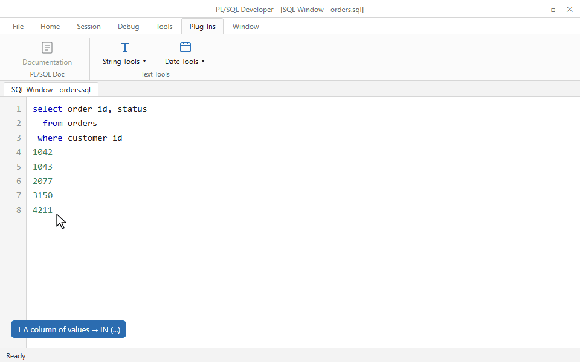
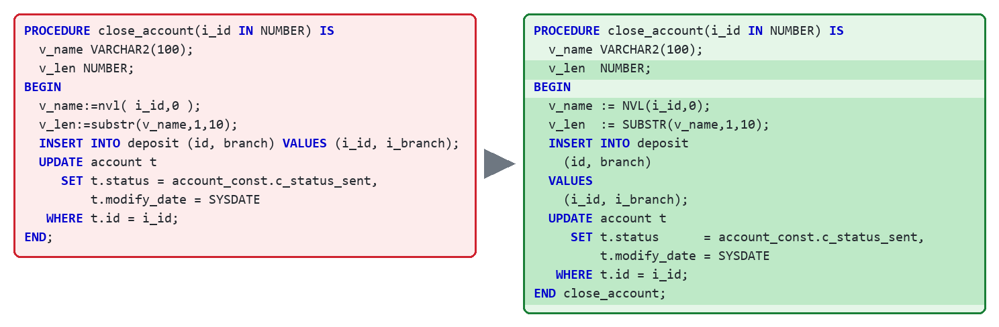
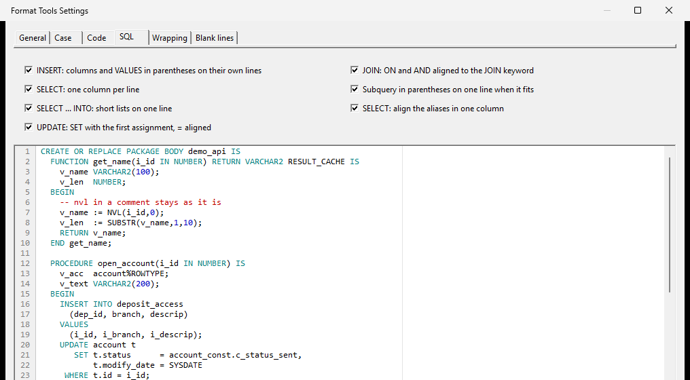
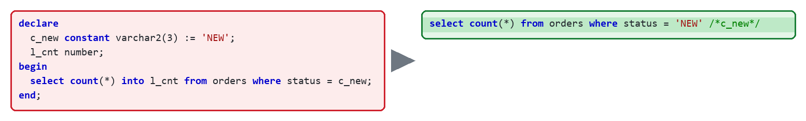
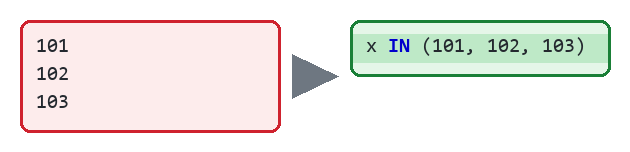

  <picture>
    <source media="(prefers-color-scheme: dark)" srcset="../assets/logo-dark.svg">
    
  </picture>

<h1 align="center">Text Tools for PL/SQL Developer</h1>

PL/SQL Developer के Beautifier से जो नहीं होता उसे पूरा करता है, पैकेज की क्वेरी को सीधे चलने लायक बनाता है और छोटे-मोटे टेक्स्ट काम हटा देता है। नेटिव 64-बिट प्लग-इन: सिर्फ़ एक DLL।

[English](../../README.md) · [Русский](README.ru.md) · [Oʻzbekcha](README.uz.md) · [Español](README.es.md) · [Português](README.pt.md) · [中文](README.zh.md) · [日本語](README.ja.md) · **हिन्दी**

  
  
  
  
   
  
  
  

## किन समस्याओं को हल करता है

### 1. Beautifier आपके कोड स्टैंडर्ड का पालन नहीं करता

`END नाम;`, कॉलम में `:=`, `INSERT` / `SELECT` / `JOIN` का लेआउट, लंबी लाइनें, खाली लाइनें। **Format Tools** Beautifier के बाद ये नियम जोड़ता है। हर नियम के लिए एक चेकबॉक्स, लाइव प्रीव्यू, और नियमों को फ़ाइल में एक्सपोर्ट करके टीम के साथ साझा किया जा सकता है।

### 2. पैकेज के कॉन्स्टेंट वाली क्वेरी चलती नहीं

**Copy SQL with constants resolved**: `c_new` बन जाता है `'NEW'`, वेरिएबल बन जाते हैं बाइंड, `INTO` हट जाता है। इसे SQL Window या Explain Plan में चिपकाएँ।

### 3. ORA-01795: `IN` में 1000 से ज़्यादा मान

लिस्ट चिपकाएँ (लाइनें या `1, 2, 3`) और Oracle को स्वीकार्य समूहों में बँटा `IN (...)` पाएँ।

### 4. छोटे काम, एक क्लिक में

camelCase / snake_case, कोट्स और `q'[...]'`, Base64 / HEX / URL, लाइनों की सॉर्टिंग, मौजूदा तारीख `TO_DATE` के रूप में, epoch और Java/.NET डेट मास्क। सभी कमांड: [commands.md](../commands.md)।

> कोड खुद नहीं बदलता: फ़ॉर्मैट से पहले और बाद टोकन की तुलना होती है, और जो नियम लेआउट से ज़्यादा छूता हो उसे छोड़ दिया जाता है।

## इंस्टॉल

1. [नवीनतम रिलीज़](https://github.com/kivilev/plsql-developer-text-tools/releases/latest) से `PlsqlDevTextTools.dll` डाउनलोड करें।
2. PL/SQL Developer बंद करें, DLL को `<PL/SQL Developer>\PlugIns` में कॉपी करें (एडमिन अधिकार चाहिए), फिर IDE शुरू करें।
3. मेन्यू न दिखे तो: **Configure → Plug-Ins**, *Text Tools* चालू करें और रीस्टार्ट करें।

PL/SQL Developer 12–17 x64, हर संस्करण CI में टेस्ट होता है। .NET की ज़रूरत नहीं, नेटवर्क का उपयोग नहीं।
हॉटकी: **Configure → Preferences → User Interface → Key Configuration**, फ़िल्टर `Text Tools`।

---

प्रश्न: [Discussions](https://github.com/kivilev/plsql-developer-text-tools/discussions) · बग: [issues](https://github.com/kivilev/plsql-developer-text-tools/issues/new/choose) · कोड: [CONTRIBUTING](../../CONTRIBUTING.md) · बदलाव: [CHANGELOG](../../CHANGELOG.md)

**Denis Kivilev**: 2005 से बैकएंड डेवलपर, Oracle Certified Professional, [Backend PRO](https://backend-pro.ru) स्कूल के संस्थापक।

**लाइसेंस:** [MIT](../../LICENSE) © 2026 Denis Kivilev

PL/SQL Developer, Allround Automations का ट्रेडमार्क है; Oracle और PL/SQL, Oracle Corporation के ट्रेडमार्क हैं। यह प्रोजेक्ट किसी से संबद्ध नहीं है।
