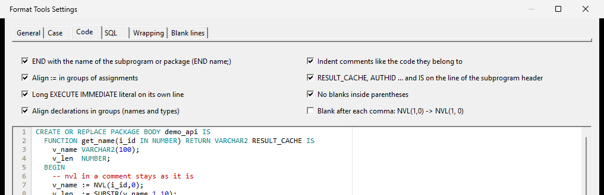
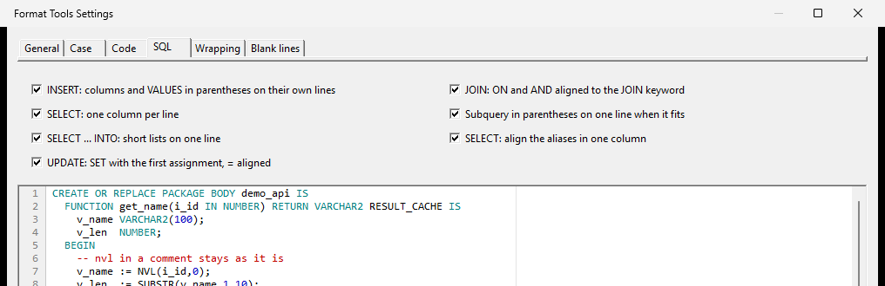
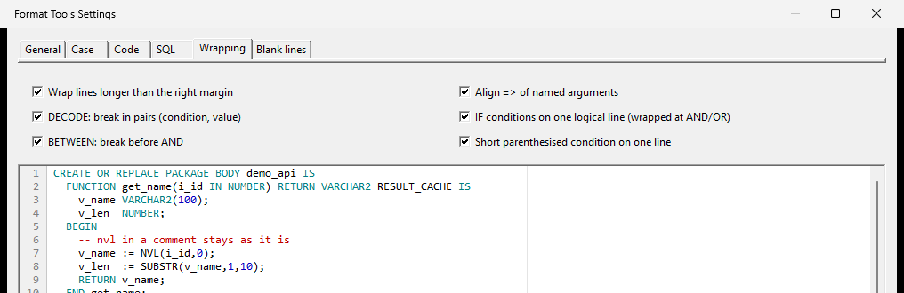
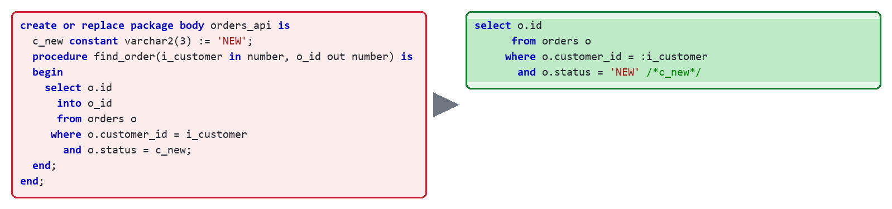
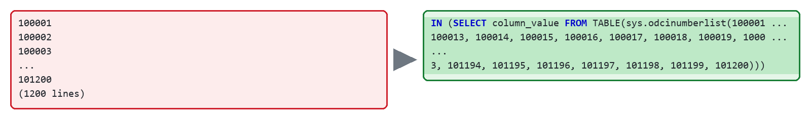
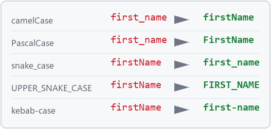
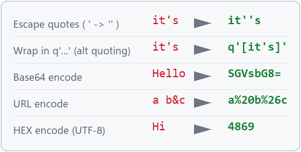
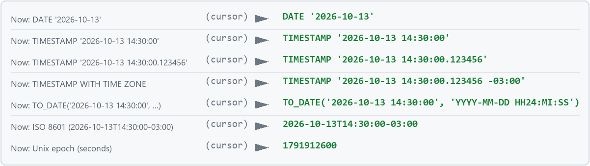
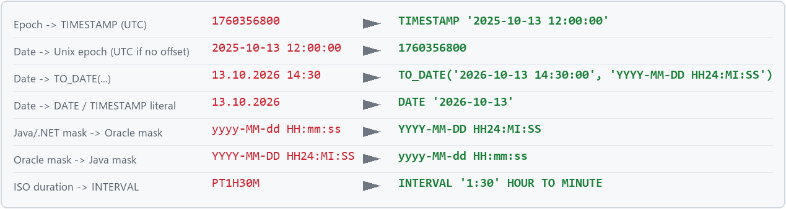

  <picture>
    <source media="(prefers-color-scheme: dark)" srcset="../assets/logo-dark.svg">
    
  </picture>

<h1 align="center">Text Tools for PL/SQL Developer</h1>

PL/SQL Developer の Beautifier では足りない整形を補い、パッケージ内のクエリをそのまま実行できる形にし、細かなテキスト作業をなくします。ネイティブ 64 ビットのプラグインで、DLL ひとつだけです。

<a href="../../README.md">English</a> &middot; <a href="README.ru.md">Русский</a> &middot; <a href="README.uz.md">Oʻzbekcha</a> &middot; <a href="README.es.md">Español</a> &middot; <a href="README.pt.md">Português</a> &middot; <a href="README.zh.md">中文</a> &middot; <b>日本語</b> &middot; <a href="README.hi.md">हिन्दी</a>

  
  
  
  
   
  
  
  

## 解決する課題

### 1. 拡張 Beautifier

*Format Tools*

IDE の Beautifier の後に実行され、ルールファイルでは表現できない整形を加えます。25 以上のオプションがそれぞれチェックボックスで、リアルタイムにプレビューできます。ルールはファイルに書き出してチームで共有でき、Beautifier の `.br` ファイルのうち共通する設定は取り込めます。

- `END 名前;`、`:=` の桁揃え、宣言の整列、コメントのインデントをコードに合わせる
- `INSERT`、`SELECT`、`SELECT ... INTO`、`UPDATE ... SET`、`JOIN ... ON`、サブクエリのレイアウト
- 長い行を右マージンで折り返し：`DECODE` は組ごと、`BETWEEN`、`||`、`=>` を揃える
- `IF` の条件を 1 つの論理行に、短い括弧グループは 1 行に
- 組み込み関数と `%TYPE` を大文字に、カンマの後の空白（任意）
- サブプログラム間に空行、閉じる `END` の前は空行なし、`EXECUTE IMMEDIATE` のレイアウト、行末の空白除去
- コード自体は変わりません。前後でトークンを比較し、レイアウト以外に触れるルールはスキップします

### 2. 定数を解決したクエリのコピー

*SQL Tools*

パッケージ、プロシージャ、ブロック内のクエリにカーソルを置くだけで、SQL Window や Explain Plan でそのまま実行できる文が得られます。

- PL/SQL の定数を値に置換：`status = c_new` → `status = 'NEW' /*c_new*/`
- 変数とパラメータはバインド変数（`:i_customer`）に、`INTO`、`BULK COLLECT INTO`、`RETURNING ... INTO` は削除
- 定数は PL/SQL と同じ順に探索：ブロック、パッケージ本体、仕様部。接続時は他のパッケージをデータベースから取得
- **Explain Plan with constants**：同じ文を IDE のプランウィンドウで表示

### 3. 文字列ユーティリティ

*String Tools*

手で打ち直していることを、選択範囲またはテキスト全体にワンクリックで。

- **リスト → `IN (...)`**：改行、`1 2 3`、`a, b`、Excel から。1000 件を超えても ORA-01795 になりません
- **ケース**：camelCase、PascalCase、snake_case、UPPER_SNAKE_CASE、kebab-case（`$`、`#`、キリル文字対応）
- **引用符**：エスケープと解除、`q'[...]'`、行 → `'a' || chr(10) || 'b'`
- **エンコード**：Base64、URL、HEX
- **行**：並べ替え、反転、重複・空行の削除、行末の空白除去、`:=` と `=>` の桁揃え

### 4. 日付ユーティリティ

*Date Tools*

現在時刻と、いつも調べ直している日付形式。

- **現在**：`DATE`、`TIMESTAMP`、`TIMESTAMP WITH TIME ZONE`、`TO_DATE(...)`、ISO 8601、Unix epoch（接続時は `SYSTIMESTAMP`）
- **変換**：epoch ↔ `TIMESTAMP`、`13.10.2026 14:30` → `TO_DATE(...)` または `DATE` / `TIMESTAMP` リテラル
- **書式**：Java と .NET の `yyyy-MM-dd HH:mm` ↔ Oracle の `YYYY-MM-DD HH24:MI`、`PT1H30M` → `INTERVAL`

例つきの全コマンド: [commands.md](../commands.md)

## インストール

1. [最新リリース](https://github.com/kivilev/plsql-developer-text-tools/releases/latest)から `PlsqlDevTextTools.dll` をダウンロードします。
2. PL/SQL Developer を閉じ、DLL を `<PL/SQL Developer>\PlugIns` にコピー（管理者権限が必要）して IDE を起動します。
3. メニューが出ない場合：**Configure → Plug-Ins** で *Text Tools* を有効にして再起動します。

PL/SQL Developer 12–17 x64。CI で全バージョンをテストしています。.NET は不要で、ネットワークも使いません。
ホットキー：**Configure → Preferences → User Interface → Key Configuration** で `Text Tools` を検索します。

---

質問：[Discussions](https://github.com/kivilev/plsql-developer-text-tools/discussions) · 不具合：[issues](https://github.com/kivilev/plsql-developer-text-tools/issues/new/choose) · コード：[CONTRIBUTING](../../CONTRIBUTING.md) · 変更履歴：[CHANGELOG](../../CHANGELOG.md)

**Denis Kivilev**：2005 年からバックエンド開発者、Oracle Certified Professional、[Backend PRO](https://backend-pro.ru) スクール創設者。

**ライセンス:** [MIT](../../LICENSE) © 2026 Denis Kivilev

PL/SQL Developer は Allround Automations の商標、Oracle と PL/SQL は Oracle Corporation の商標です。本プロジェクトはどちらとも関係ありません。
